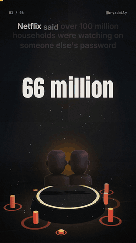

# Reel Engine

One line in, finished vertical reel out. Give it a topic and it writes a fact-checked script, records the voice, animates every scene in 3D, times the captions to each spoken word, and delivers the video. It also runs on its own every night.

<p align="center"></p>

```bash
npm run reel -- "why Costco's hot dog combo is still \$1.50" --style 3d
# → out/2026-10-28-why-costco-s-hot-dog-combo-is-still-1-50-3d.mp4   (1080×1920, ~25s)
# → out/2026-10-28-why-costco-s-hot-dog-combo-is-still-1-50-3d.txt   (caption, hashtags, sources)
```

## How it works

1. **Script.** `claude -p` writes a 5–6 scene script as JSON against a fixed schema (hook, count, bars, scale, line, end). It must cite real sources, rate its own confidence, and only use numbers it can back up.
2. **Voice.** `edge-tts` voices each scene and returns per-word timestamps. Captions, counters and camera moves all key off those timestamps, so a number lands on screen the moment the narrator says it. No transcription pass.
3. **Animation.** A Remotion composition renders the scenes. The default `3d` style puts each scene on a station on one lit floor, and the camera orbits and flies between them. Money amounts become coin stacks (one coin = 25¢), comparisons become lit bars or a tipping scale, and each impact gets a camera punch, a light flash and a floor shockwave.
4. **Post kit.** Caption, hashtags, sources and an AI-narration disclosure go in a `.txt` next to the video.
5. **Delivery (optional).** Text the kit and video over iMessage, and upload to YouTube through the official Data API.

## Styles

| `--style` | Look |
|---|---|
| `3d` (default nightly) | Three.js scene via `@remotion/three`: coin stacks, glowing pins, 3D bars, camera fly-throughs |
| `data` | 2.5D stat stage: SVG perspective floor, ticking counters, bars, a scale |
| `demo` | The script choreographs objects on the exact spoken word (*"spill"* → the glass tips and spills) |
| `collage` | Cork-board hook, polaroids, red stamps and self-drawing circles |
| `footage` | Pixabay stock clips under kinetic typography |

## Nightly mode

```bash
npm run reel -- --auto --deliver
```

`--auto` rotates a topic lane by day (curiosity, how X makes money, true stories, belief vs. evidence, AI tips) and keeps a history so topics don't repeat. Each lane has its own honesty rule. `scripts/nightly.sh` is the launchd entry point: one reel per night, and the Mac stays awake while it renders.

## Why the sources file

AI scripts can state wrong facts confidently. A reel is only as good as its facts, so every one ships with where its claims come from and a confidence rating. Nothing gets posted without a human look. That's also why posting stays manual: the engine renders and delivers, and a person adds a trending sound and hits post.

## Setup

```bash
npm install
pip install edge-tts      # 7.x
cp .env.example .env      # all keys optional
npm run reel -- "your topic"
```

Requires Node 20+, Python 3, ffmpeg, and the [Claude Code CLI](https://docs.claude.com/en/docs/claude-code) (`claude -p` writes the scripts). Add `--lang es` for Spanish and `--voice ava` for the second voice.

## Stack

Node · Remotion 4 · Three.js / React Three Fiber · edge-tts · ffmpeg · Claude Code CLI · YouTube Data API v3. Runs locally: about 4 minutes per 3D reel on a 2020 Intel MacBook Air (8GB), $0 per reel beyond the Claude plan.

## Credits

3D emoji art: [Microsoft Fluent Emoji](https://github.com/microsoft/fluentui-emoji) (MIT), downloaded on demand. Fonts: Anton and Inter (SIL OFL) via `@remotion/google-fonts`. Sound effects are synthesized with ffmpeg.
